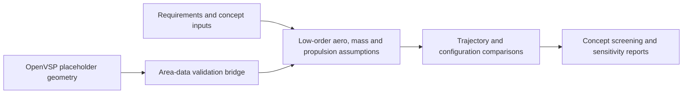

# Supersonic RC Aircraft — Concept Sizing and Engineering Tools

**Status:** Active research/design project; **preliminary model, not flight-validated**  
**Code:** Private (research and team-development repository)  
**Focus:** Python, aircraft performance modeling, numerical methods, CAD interoperability, automated tests

## The problem

A high-speed remote-control aircraft concept needs to survive early feasibility checks before spending time and money on detailed CAD, CFD, hardware, or propulsion. A single “predicted top speed” is not enough: mass, drag uncertainty, inlet losses, available thrust, and trajectory interact.

## What I worked on

- Built and iterated an integrated **low-order aircraft sizing and concept-screening workflow** for a proposed high-speed RC aircraft project.
- Connected preliminary **aerodynamic drag, propulsion and inlet, area-rule, trajectory, and optimization** calculations to support systematic design comparisons.
- Added an **OpenVSP geometry-generation and area-data bridge**, including input validation before area-distribution results feed the model.
- Maintained structured engineering documentation, an equation/source register, and model-status rules that distinguish concept-screening outputs from validation evidence.
- Organized numerical tests for atmosphere, drag, propulsion, inlet, geometry, and OpenVSP-bridge components.

## Architecture

## Engineering judgment and validation

The model is explicitly labeled **preliminary, version 0.3**. Its current use is concept screening, sensitivity analysis, method comparison, and workflow development. The repository documents **10 relevant test modules**; their presence is not a claim that all tests passed on every platform. OpenVSP placeholder geometry has been generated and visually inspected, but key geometry metrics need independent quantitative confirmation. **Aircraft CFD, FEA, validated installed thrust, a design freeze, and supersonic flight have not been completed.**

## Why this matters

It demonstrates how I approach open-ended aerospace engineering: decompose uncertain physics, build reusable analysis tools, identify what has and has not been validated, and use evidence to decide the next expensive step.

**Evidence available privately:** model status, engineering roadmap, source/equation registers, preliminary solver modules, and automated test modules. No proprietary geometry or unverified performance claims are shared here.