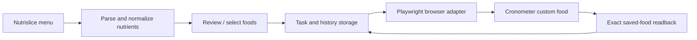

# Nutrislice → Cronometer — Browser Automation and Food Data Validation

**Status:** Working local application with documented end-to-end tests and Windows acceptance evidence; some features intentionally disabled  
**Code:** Private (browser integrations, personal data, and safety-sensitive state management)  
**Focus:** Python, Playwright, local web UI, SQLite, browser automation, validation, cross-platform engineering

## The problem

I wanted to stop manually recreating dining-hall foods and micronutrient fields in Cronometer. The two services did not offer an integration I could rely on for this workflow, and entering foods in a web browser creates state, duplicate-submission, and data-fidelity risks.

## What I built

- An application that **reads Nutrislice menu data, previews foods, lets a user select entries, and creates custom foods in Cronometer through an authenticated browser session**.
- A local control center with **menu previews, activity, food history, and read-only food inventory**.
- A layered architecture separating **domain models, application services, storage, browser integrations, local HTTP interfaces, and operating-system-specific process management**.
- Data normalization that preserves the difference between **missing, zero, and qualified** nutrition values, plus exact-name and serving checks before comparing remote foods.
- Safety-oriented save handling: a durable save boundary, post-save readback, duplicate checks, and explicit handling of uncertain browser outcomes to avoid blindly repeating a submission.
- A private Windows host workflow with separate local application state and remote access controls.

## Architecture

## Validation and limits

The repository includes **24 named test modules**, a deterministic release-check entrypoint, and a GitHub Actions workflow targeting **Windows and macOS**. Internal acceptance documentation reports a **successful approved TEST-food creation and saved-food readback** on the Windows PC, followed by an exact-duplicate check that caused **no second save**. It also documents restart/recovery and private remote-access checks, with an independent-account device test explicitly waived. These are historical recorded checks, not tests rerun for this portfolio.

**Not claimed:** a public hosted service, automatic diary entry, verified multi-user isolation, or deployed automatic scheduling. Existing-food updates, deletion, and scheduling remain intentionally locked in the documented release.

## Why this matters

This project pushed me from writing scripts that work once toward designing **reliable, recoverable automation around a real external UI**. The hardest part was correctness and repeatability, not the first click.

**Evidence available privately:** end-to-end test cases, release checks, data-model documentation, recovery and verification code, and Windows acceptance report. No session data or credentials are included.