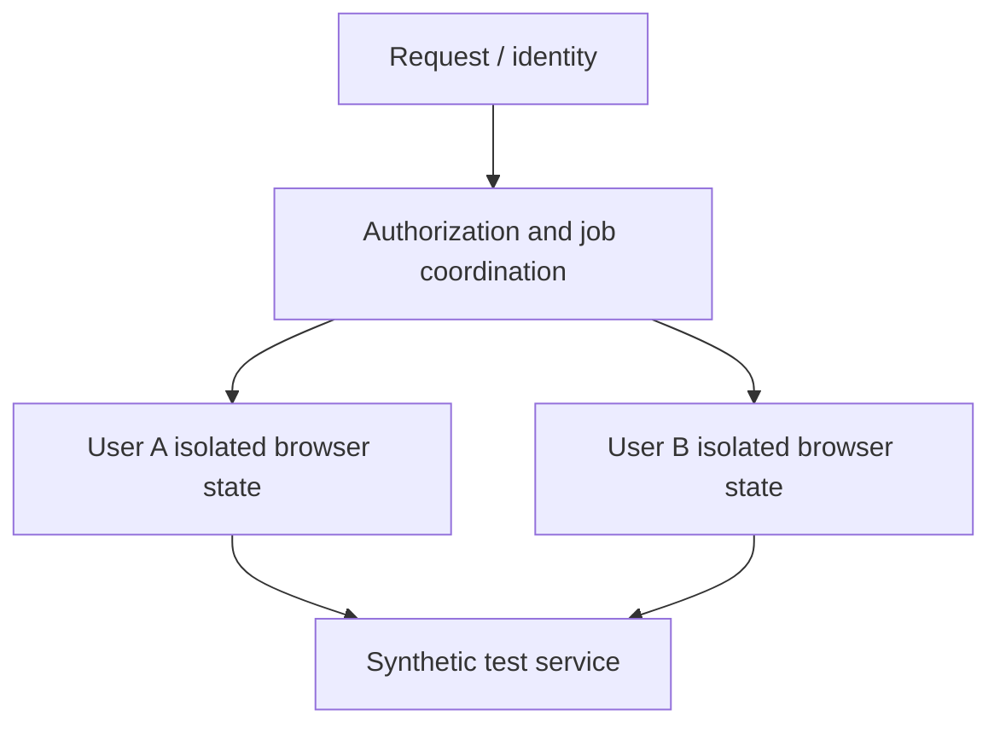

# Multi-User Browser Isolation — Controlled Architecture Prototype

**Status:** Experimental fork; **not a production multi-user service**  
**Code:** Private  
**Focus:** Python, browser session isolation, security design, system boundaries, synthetic testing

## The problem

The personal nutrition logger was designed for one locally controlled account. Supporting multiple independent users on a single host introduces more difficult requirements: account separation, browser profile ownership, concurrency, authorization, and failure recovery.

## The approach

- Forked the existing application while preserving its single-user history, then **separated prototype data and browser profiles** from the original application.
- Defined a **controlled local website and synthetic accounts** for isolating browser-session experiments from real services.
- Investigated native Windows worker behavior as a comparison point for a more isolated execution model.
- Kept the live Nutrislice/Cronometer integrations and public deployment **disabled** during the experiment.
- Used explicit safety gates: a design is not accepted as isolated just because it appears to work for two test accounts.

## Conceptual boundary

## What is and is not proven

The repository describes a **prototype testing plan using two synthetic accounts**. The present default-branch README does **not** establish production-ready containment or live multi-user operation, and a referenced detailed status directory was not available from the connected default branch at review time. This overview intentionally avoids presenting proposed isolation controls as demonstrated security guarantees.

## Why this matters

The project shows my interest in **engineering security boundaries and testable assumptions before deploying automation to other users**, rather than generalizing a personal script without controls.