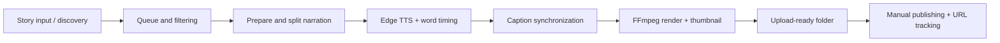

# Short-Form Video Production Pipeline — Cross-Platform Media Automation

**Status:** Implemented local content-production workflow; publishing remains manual  
**Code:** Private  
**Focus:** Python, FFmpeg, text-to-speech, caption alignment, pipeline orchestration, regression testing

## The problem

Producing a short-form video from a text story involves several manual steps: select content, prepare narration, synchronize captions, render media, create a thumbnail, and organize upload assets. A change to one step can disrupt downstream timing or file state.

## What I built

- A modular pipeline that **ingests or selects stories, manages a queue, prepares narration, splits long stories, and generates short-form videos**.
- **Edge TTS word-boundary timing** mapped to punctuation-aware captions and FFmpeg video rendering, rather than approximating subtitle timing from character counts.
- Background clip selection, rendering, thumbnail generation, and packaging of titles/captions and media into **upload-ready folders**.
- Generation-state management to distinguish queued, pending-upload, uploaded, and failed items; regeneration **avoids modifying previously uploaded videos**.
- A macOS port with shared code kept compatible with Windows, plus regression and repository-safety checks in cross-platform CI.

## Architecture

## Testing and limits

The repository contains targeted tests for **caption synchronization, rendering, story splitting, background media, portable paths, repost tracking, and repository safety**, with GitHub Actions configured for macOS and Windows. Those are repository tests and workflow configuration; this overview does not claim a fresh CI run or particular published view counts.

Uploads are **manual**, and private queue history, account settings, generated media, analytics, and licensed assets are excluded. This is a production-workflow automation project, **not a claim of a fully autonomous social-media publishing service**.

## Why this matters

This project taught me how to make **sequential media-processing stages agree on their contracts and state** and how to support a codebase on two operating systems without committing private content.