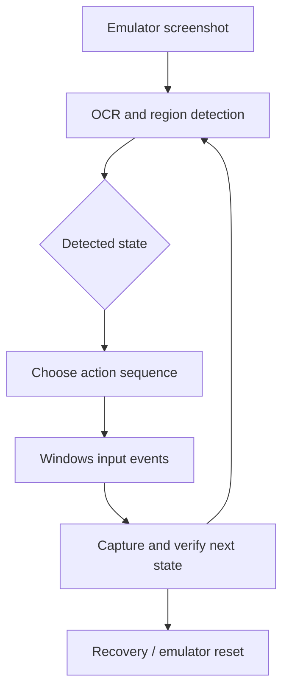

# Windows Game UI Automation — Screenshot Detection, OCR, and Recovery

**Status:** Working source implementation; no recent live verification performed for this portfolio  
**Code:** Private  
**Focus:** Python, Windows UI automation, OCR, image matching, emulator state management

## The problem

A desktop emulator exposes only a graphical interface. Automating repeated sequences requires detecting the current screen rather than assuming that every click advances the application to the expected state.

## What I built

- A Python controller for a **Windows BlueStacks emulator** that locates the correct window and captures its content.
- **OCR-based recognition of different journey states**, with different action sequences and reward-handling branches.
- Image/region detection for result screens, plus window-handle reacquisition when capture fails.
- Configurable timing and **periodic emulator resets**, including a scheduled pause/recovery window.
- Separate modules for visual detection, clicking, reset handling, and interaction sequences.

## Architecture

## Scope and evidence

The repository contains the detection and action modules plus debugging utilities. The main-loop implementation handles a limited set of known journey/reward states. **A complete production regression suite, Discord control, and Excel analytics are not established by this repository snapshot**, so they are not claimed here. This is a UI-reliability learning project, not a customer-facing product.

## Why this matters

The transferable skills are **state detection, explicit error paths, repeatable UI interaction, and recovery from missing windows or unexpected screens**.